<style>
.reveal section[data-background-image] h1:not(:empty) {
  background: rgba(0, 0, 0, 0.6);
  padding: 20px 40px;
  border-radius: 10px;
  display: inline-block;
  color: AliceBlue;
}
.reveal section.credits ul {
  columns: 2;
  column-gap: 40px;
  margin: 0;
}
.reveal section.credits li {
  font-size: 0.55em;
  line-height: 1.25;
  break-inside: avoid;
  margin-bottom: 6px;
}
.reveal section.extra ul {
  margin: 0;
}
.reveal section.extra li {
  font-size: 0.75em;
  line-height: 1.3;
  margin-bottom: 14px;
}
</style>

# Ma relation toxique avec Python

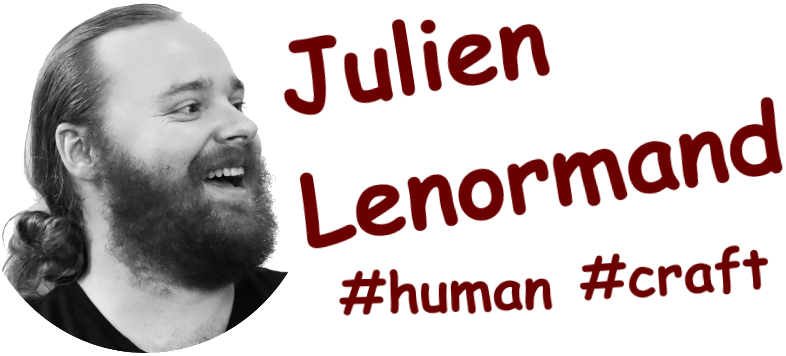

Notes:
Oui oui bonjour monsieur le psy, désolé je vais être un peu speed aujourd'hui, d'habitude je prends une heure mais là on n'a que 15 minutes, je répondrais à vos question après.
Je me pose sur le divan, et je vous raconte tout.
D'ailleurs je vous ai fait un powerpoint comme support visuel, mais c'est facultatif, vous pouvez m'écouter les yeux fermés, je vais surtout vous raconter mon histoire. Et y'aura un lien à la fin si vous souhaitez le télécharger.

---

# Le commencement

-v-

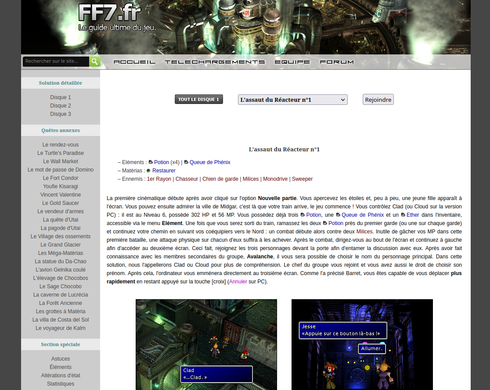  <!-- .element: width="900px"; class="fragment" -->
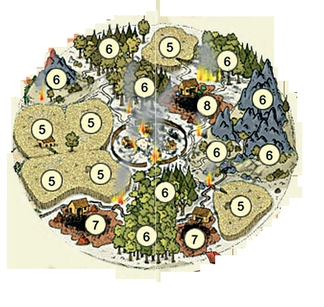  <!-- .element: width="900px"; class="fragment" -->

Notes:
2008, J'avais 14 ans, et comme tous les garçons de mon âge je n'avais que deux choses en tête : comment on fait des sites internet (ff7.fr) ? Et comment on fait des jeux vidéos (travian, monzoo, ) ?

-v-

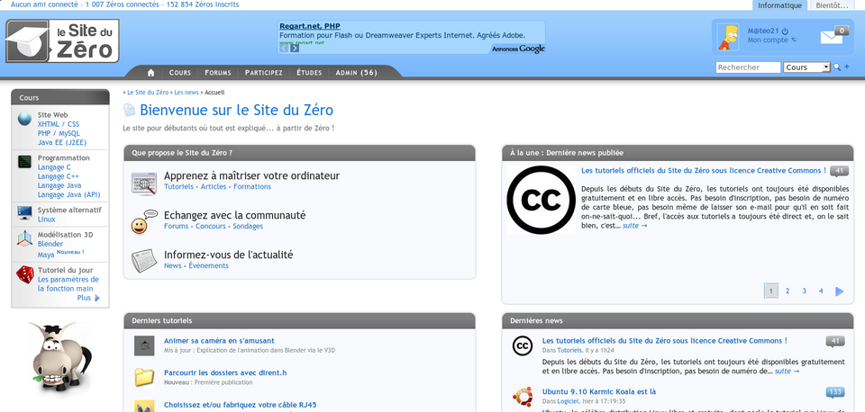  <!-- .element: width="900px"; class="fragment" -->

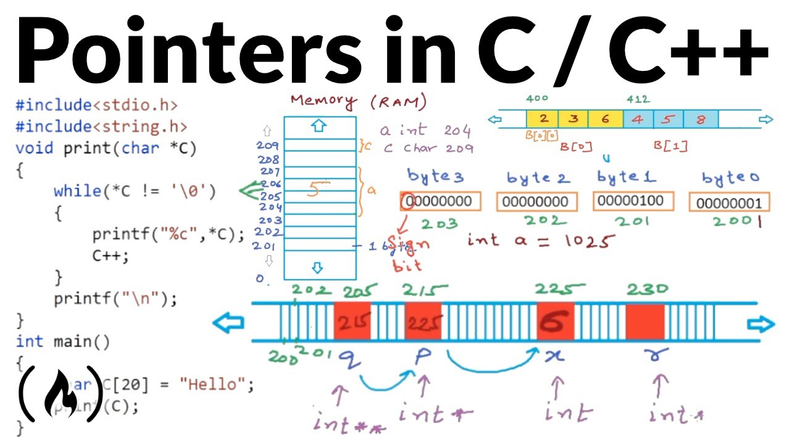  <!-- .element: width="900px"; class="fragment" -->


Notes:
J'ai batifolé un peu avec HTML et CSS (en lisant le site du Zéro), sympa mais pas trop accroché
J'ai été curieux, j'ai testé le C, et j'ai détesté, pas du tout mon truc. Quel prise de tête (les pointeurs).
J'ai laissé tout ça un peu de côté.

-v-

⚡ ❤️ 😍  <!-- .element: style="font-size:4em"; class="fragment" -->

🐍  <!-- .element: style="font-size:4em"; class="fragment" -->

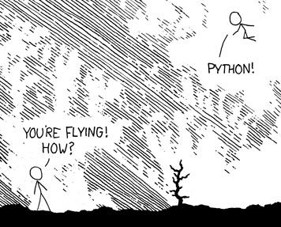  <!-- .element: width="600px"; class="fragment" -->

Notes:
2010 Mais deux ans plus tard, le coup de foudre !!! (foudre, coeurs, emoji)
Je ne me souviens pas exactement comment je l'ai rencontré, mais je suis tombé sous le charme de son mélange de lisibilité (IDLE), d'expressivité (Turtle, Tkinter), de communauté (Pythonnerie, Sam&Max, ), de potentiel (jeu vidéo, fenrensics, network, ...)

-v-

```java
// Java
private static final HashMap<String, String> hashmap = HashMap<String, String>();
```
<!-- .element: class="fragment" -->

```python
# Python
hashmap = {}
```
<!-- .element: class="fragment" -->

```python
>>> import this
The Zen of Python, by Tim Peters

Beautiful is better than ugly.
Explicit is better than implicit.
Simple is better than complex.
Complex is better than complicated.
Flat is better than nested.
Sparse is better than dense.
Readability counts.
[...]
```
<!-- .element: class="fragment" -->

Notes:
Et j'ai commencé à me coucher tard pour continuer de l'écrire, à y penser tous les jours, à m'intéresser à toutes ses facettes, ... Je l'adorais.
J'ai voulu faire des mods pour Minecraft, donc en Java, mais je ne comprenais rien à toute sa complexité bureaucratique (hashmap), je lui préférais 100x Python.
Je voulais tout faire avec Python.

-v-

* Ada  <!-- .element: class="fragment" -->
* PHP  <!-- .element: class="fragment" -->
* C  <!-- .element: class="fragment" -->
* Asm  <!-- .element: class="fragment" -->
* C++  <!-- .element: class="fragment" -->
* Bash  <!-- .element: class="fragment" -->
* Java  <!-- .element: class="fragment" -->
* ...  <!-- .element: class="fragment" -->

<!--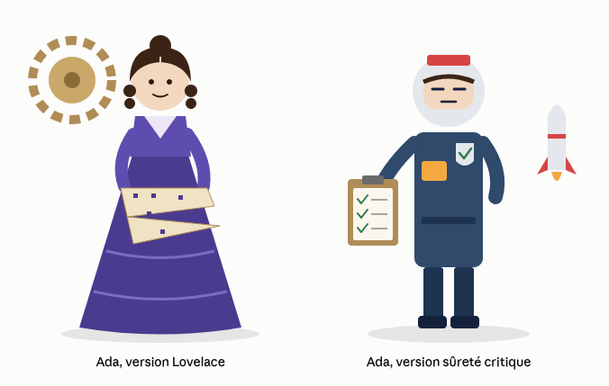-->  <!-- .element: width="800px"; class="fragment" -->


<!--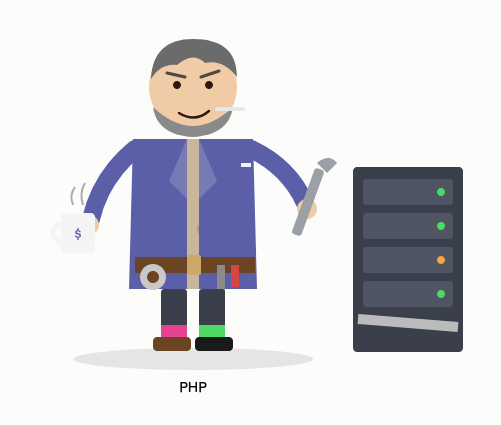-->  <!-- .element: width="500px"; class="fragment" -->

<!---v--->

<!--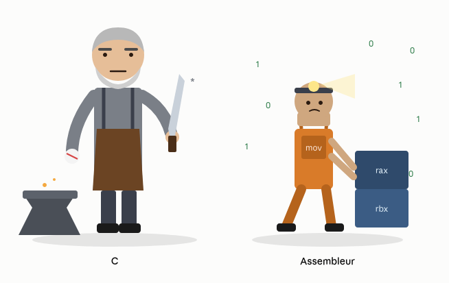-->  <!-- .element: width="1100px"; class="fragment" -->

<!---v--->

<!--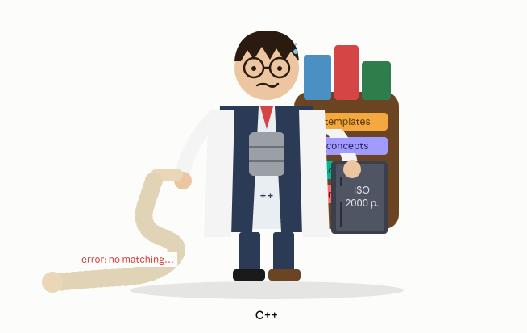-->  <!-- .element: width="400px"; class="fragment" -->
<!--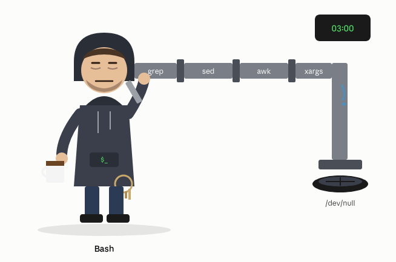-->  <!-- .element: width="400px"; class="fragment" -->
<!--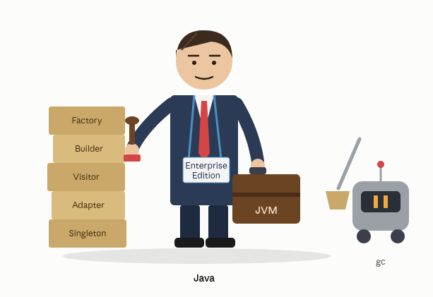-->  <!-- .element: width="400px"; class="fragment" -->

Notes:
Un peu par hasard, je me suis retrouvé en études d'informatique (DUT, pour les vieux).
J'y ai rencontré Ada, que j'ai trouvé séduisante sur son côté un peu stricte mais sécurisant.
Puis PHP, avec qui ça n'a pas trop matché.
C et Assembleur étaient peu amicaux, un peu trop bourrus à mon goût.
C++ était agaçant à être savant et pédantique.
Bash ressemblait un peu trop à du bricolage de tuyaux.
Java était trop sérieux.
Bref, plein de nouvelles rencontres, mais tout me ramenait toujours à Python.

---

## Boulot

-v-

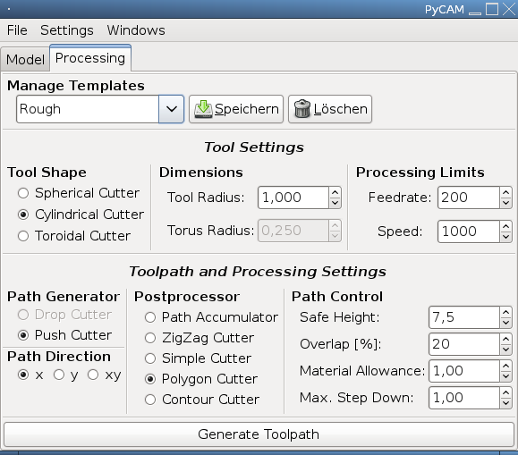  <!-- .element: width="900px"; class="fragment" -->
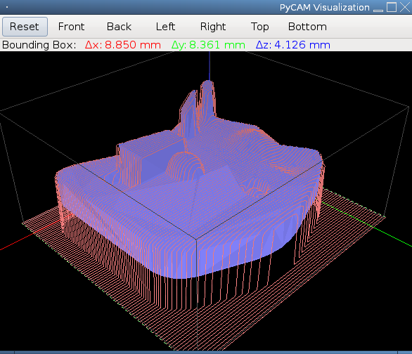  <!-- .element: width="900px"; class="fragment" -->

Notes:
Et puis j'ai commencé à travailler avec, par exemple pour mon premier stage.
Je devais faire de l'optimisation sur des algos existants de fraisage, et développer de nouveaux algos efficients. Et j'ai découvert que bien qu'il était simple d'écrire des algos en Python, il était difficile de les rendre performants.
https://pycam.sourceforge.net/img/screenshot-processing-settings.png
https://pycam.sourceforge.net/img/screenshot-finishing-operation.png

-v-

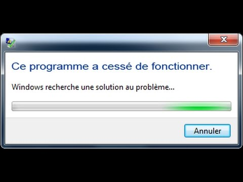  <!-- .element: width="900px"; class="fragment" -->

😅  <!-- .element: style="font-size:3em"; class="fragment" -->

Notes:
2018 Et j'ai continué avec mon premier CDI, la refonte complète des logiciels de gestion de Crise nucléaire chez un grand acteur du nucléaire. Gros enjeu. Equipe junior. En Python. (emoji stress)
Je me souviens d'une anecdote : le premier jour, après avoir rencontré un peu tout le monde, je fais le setup de mon poste de travail. J'arrive enfin à lancer l'application. Je clique sur un bouton, BAM, crash, application.exe a cessé de fonctionner !!
On avait d'énormes problème de qualité : qualité de code, qualité de test, qualité d'architecture, ... Il a fallu tout apprendre, tout faire, et Python n'a pas beaucoup aidé à cela. Il était facile d'écrire du code qui se lance, mais difficile de faire en sorte qu'il fonctionne 100% du temps en prod. J'aurais bien aimé la robustesse des process d'Erlang, la déclarativité des checked exceptions de Java, ou les types Union de Haskell.

-v-

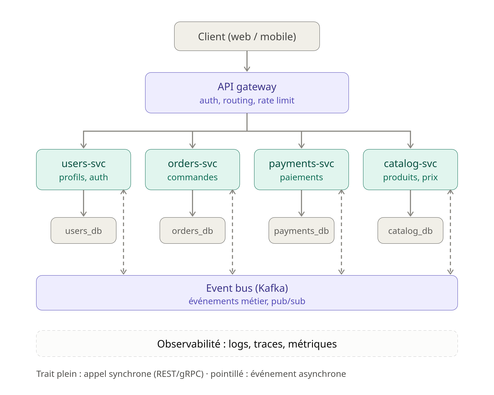  <!-- .element: style="height: 900px; margin: 0 10px;" class="fragment" -->
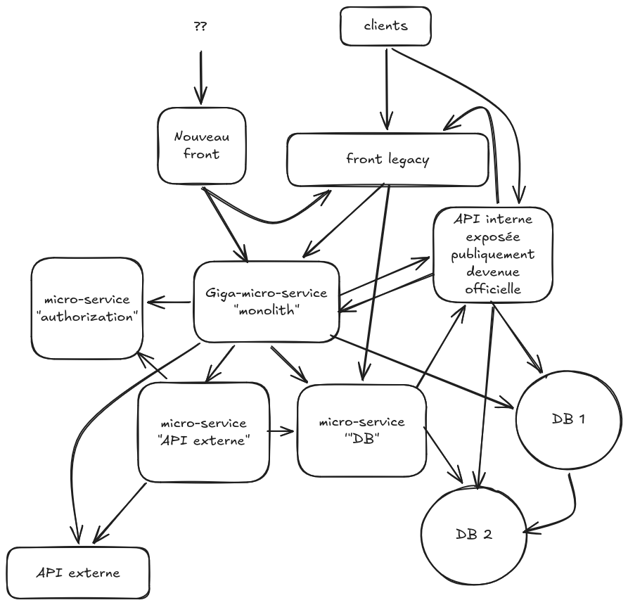  <!-- .element: style="height: 900px; margin: 0 10px;" class="fragment" -->

Notes:
Puis j'ai changé de boulot, et j'ai travaillé dans la métrologie des batteries électriques. Encore du Python. Application micro-services (dessin archi théorique versus réelle), problème de perf, bug d'import, trop grosse conso de RAM pour du semi-embarqué, couplage pénible avec l'équipe front en JS, ...

-v-

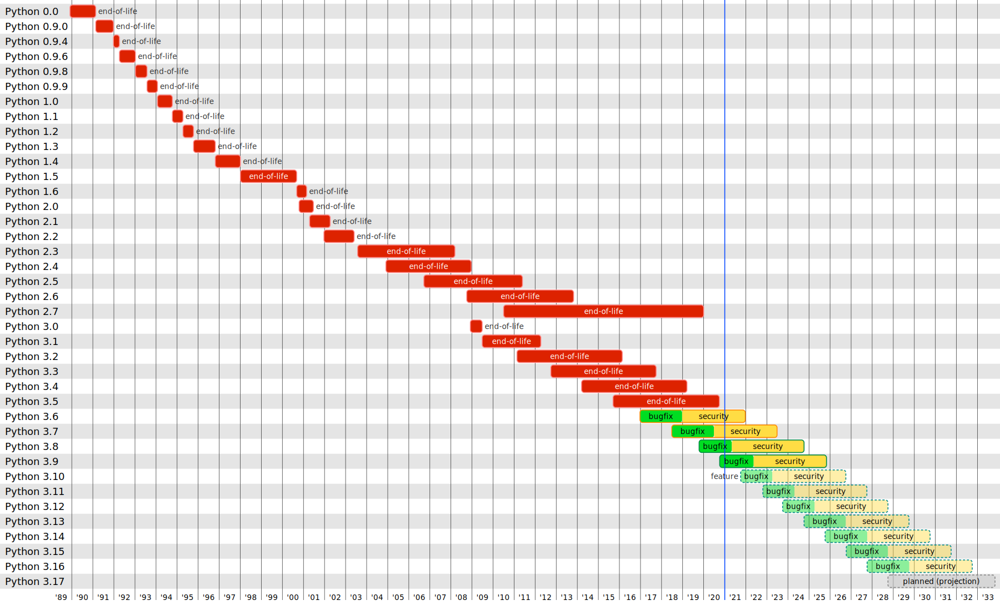  <!-- .element: width="1850px"; class="fragment" -->

Notes:
Puis j'ai changé de boulot, et j'ai travaillé dans les ERPs. Encore en Python. Mais du Python 2.0. En 2021. C'était pas précisé dans l'annonce. Aucun typing, aucun tests full-stack archi-lents, toujours pas d'isomorphisme avec le front en JS, ...

-v-

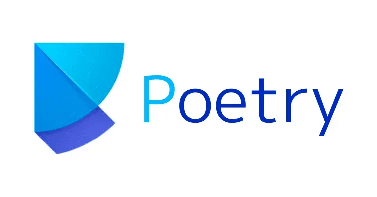  <!-- .element: width="900px"; class="fragment" -->
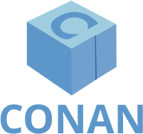  <!-- .element: width="500px"; class="fragment" -->

Notes:
Puis j'ai changé de boulot, et j'ai travaillé dans la sûreté aéro-portuaire. Théoriquement du C++, mais avec beaucoup de Python pour le build, la CI, le tooling, les tests, ... On travaillait sur des environnements air-gaped, donc sans accès à PyPI. Le "batteries included" de Python, vrai en 2000, l'est moins en 2022. Je ne m'étonne plus que tout le monde utilise requests au lieu de urllib. Et que packager du Python pour une installation Offline soit si compliqué. Et que le tooling n'est pas mature pour le SBOM.

-v-

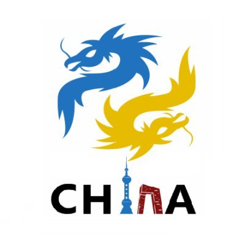  <!-- .element: width="800"; class="fragment" -->

Notes:
Puis j'ai changé de boulot, et j'ai travaillé dans la recharge de voitures électriques. Le soft qui était vendu est en C++, mais tout le reste, tout l'outillage, la CI/CD, le testing, le quality management, la gestion du parc d'équipements, ... étaient fait en Python. Et on avait encore des problèmes de perf, et de packaging, et de miroir en Chine. Et l'intégration avec RobotFramework.

-v-

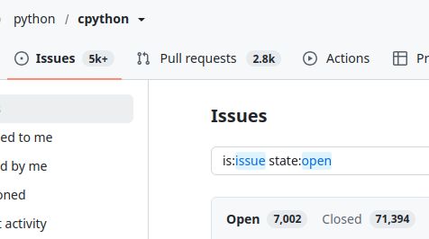  <!-- .element: width="800"; class="fragment" -->

Notes:
Puis j'ai changé de boulot, et j'ai bossé dans la télémaintenance médicale. A part le site web en JS, tout le backend, et même une partie du gros embarqué était en Python. Et des problèmes de perf, de reliability, ... C'était loin d'être le premier problème, mais y'a des points qui font mal. Pas de SBOM, et des milliers d'issues ouvertes sur GitHub, combien de CVE ? et c'était avant la flambée des IA.

-v-

  <!-- .element: style="height: 900px; margin: 0 10px;" class="fragment" -->
  <!-- .element: style="height: 900px; margin: 0 10px;" class="fragment" -->

Notes:
Puis j'ai changé de boulot, pour bosser dans la lutte anti-phishing. Un énorme tas de spaghetti micro-services en Python, avec la roue réinventée, des énormes problèmes de perf, de stabilité, de testabilité, de typage, de déploiement, ...

---

## Conclusion ?

😢 <!-- .element: style="font-size:3em"; class="fragment" -->

* perf: CPU, RAM, GIL, free-threading/JIT, ...  <!-- .element: class="fragment" -->
* lang: walrus, async, typing, import, exceptions, ...  <!-- .element: class="fragment" -->
* tool: venv, linter, typechecker, project manager, ...  <!-- .element: class="fragment" -->
* ops: packaging, Windows, mobile, front, Conda et Torch, ...  <!-- .element: class="fragment" -->
* Python 2 ...  <!-- .element: class="fragment" -->
* "There should be one-- and preferably only one --obvious way to do it." ...  <!-- .element: class="fragment" -->
* Python = C et C++ et Fortran et ...  <!-- .element: class="fragment" -->
* ...  <!-- .element: class="fragment" -->

Notes:
bah Python c'est tout pourri !
Et encore, j'ai pas parlé des venv, merci uv ! Ni du walrus operator (fine by me, mais a fait péter un cable à la communauté et à Guido)
Ni de la GIL qui empêche le multi-threading. Ni du split causé par l'async. Ni de la distinction entre import package et distribution package. Ni du déploiement sur Windows. Ni de Conda.

---

## Les bons côtés

Zen of Python  <!-- .element: class="fragment" -->

Batteries included  <!-- .element: class="fragment" -->

> Python is the second best language for everything

<!-- .element: class="fragment" -->

Notes:
Là j'ai surtout présenté les problèmes professionnels auxquels j'ai été confronté, mais j'ai beaucoup apprécié travailler avec des développeurs Python, moins à la recherche de la perfection que du "good enough".
Du code souvent simple à lire, toujours bien indenté, aucune difficulté à compiler, aucun bug de linker. Et j'en passe.

-v-

> Come for the language, stay for the community.

Notes:
Et vient le moment communauté. J'ai toujours trouvé du support, des ressources pour apprendre Python, approfondir. Sa popularité, et l'absence de gatekeeping, m'ont fortement aidé à progresser. De très bonnes docs (par rapport à la moyenne des autres langages). Très peu de bugs. Des choix stratégiques de dévellopement du langage que j'approuve.

-v-

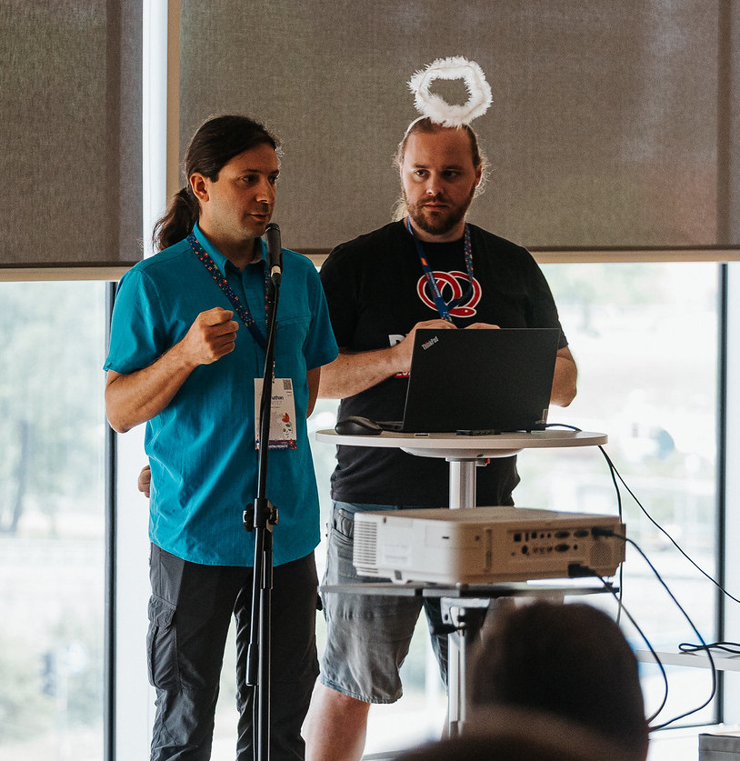  <!-- .element: width="900px" -->

Notes:
Et les PyCon sont parmi mes conférences préférées, que ce soit en terme d'ambiance, de diversité des personnes et des métiers car Python est un grand langage. J'y ai donné certaines des conférences dont je suis le plus fier.
Et très fier aussi d'avoir été sélectionné deux années de suite à EuroPython, seule conférence en anglais que j'accepte de faire vu mon niveau en anglais !

-v-

VOUS  <!-- .element: style="font-size:12em"; class="fragment" -->

Notes:
Et puis y'a le meetup, que je découvre fin 2022, mais dont j'apprécie énormément les échanges et la diversité. Comme je le dis à chaque fois, je suis une bille en DataScience, et j'ai la chance de croiser plein de personnes expertes, ou très fortes, ou juste très curieuses là-dedans, pour m'apprendre plein de choses.

---

## Choix

> Ce n'est pas le programmeur qui choisit son langage, c'est le langage qui choisit son programmeur. - 0L1v4nd3r

<!-- .element: class="fragment" -->

Notes:
J'ai "choisi" Python autant que j'ai été choisi par lui. #baguetteDeSorcier
J'ai fait mon premier stage avec, car j'étais pas mauvais et j'avais une opportunité.
J'ai continue à en faire par la suite car j'en avais déjà fait avant.
Ca s'est auto-entretenu. J'ai parfois codé dans d'autres langages, mais toujours avec un léger contre-coeur. Car je n'étais pas habitué, certaines choses n'étaient pas simples, ou possibles, ou familières. 

-v-

* Eiffel  <!-- .element: class="fragment" -->
* Rust  <!-- .element: class="fragment" -->
* Clojure  <!-- .element: class="fragment" -->
* TS  <!-- .element: class="fragment" -->
* ...  <!-- .element: class="fragment" -->

Notes:
Quelque fois, j'ai voulu avoir envie d'apprendre un nouveau langage (Eiffel, Clojure, Rust, TS, ...) mais je me dégonfle assez vite, car il faut faire des efforts, et y mettre du temps, et du cerveau.
Et si on n'avait plus besoin de cerveau pour coder ????

---

## IA

🤖 <!-- .element: style="font-size:6em" -->

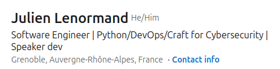  <!-- .element: width="1300px" -->

Notes:
L'arrivée de l'IA. Même si j'ai été rapidement convaincu par ses capacités, progrès, et l'importance du changement en cours, je n'ai pas pris la vague tout de suite, j'ai attendu un peu.
Et maintenant, je suis la même tendance que les autres : j'écris de moins en moins de code moi-même, et je relis de moins en moins les PRs que mes agents produisent (de façon contrôlée, encore pour le moment).
Mais j'ai déjà eu quelques cas, où finalement le code qui implémente le service ou la lib m'importe peu, tant que je peux valider son comportement externe et certaines propriétés non-fonctionnelles. Je n'ai pas de plaisir particulier à ce qu'il y ait du Python à l'intérieur, et des fois ce n'est même plus un bon choix.
Ce n'est plus qu'une question de semaines avant que je franchisse le seuil, que je commence à déléguer l'écriture dans un autre langage. Je le fais déjà pour le JS du front, ou le CSS, ou le Bash, ou les queries Mongo, ...
Le dernier rempart finira par céder. Et je perdrai le plaisir de coder professionnellement avec Python. Je gagnerai le plaisir de pouvoir choisir librement l'outil le plus adapté au problème.
Je vais peut-être devoir mettre à jour ma tagline LinkedIn.

-v-

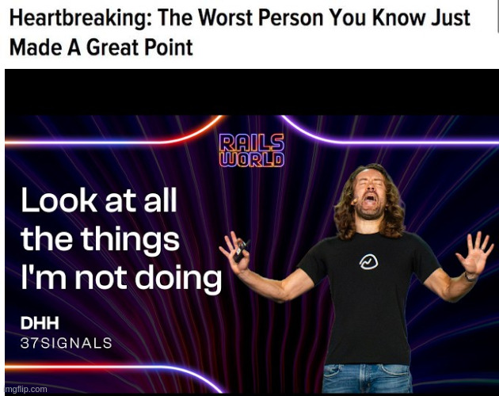  <!-- .element: width="1300px" -->

Notes:
Y'a eu récemment une keynote à la Ruby on Rails par son créateur DHH, qui déjà très controversé, a balancé de l'huile sur le feu en racontant qu'il avait complètement arrêté de faire du RoR, et à la place "Rust dans le backend, native pour le front".

-v-

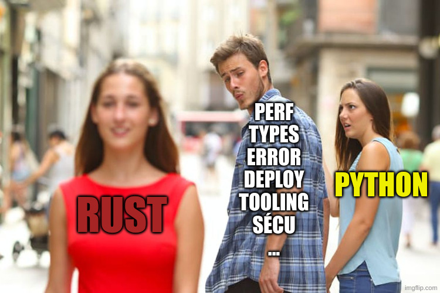  <!-- .element: width="1300px" -->

-v-

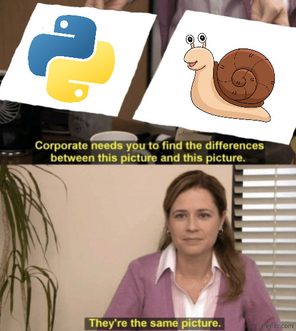  <!-- .element: width="900px" -->

---

## Evolution

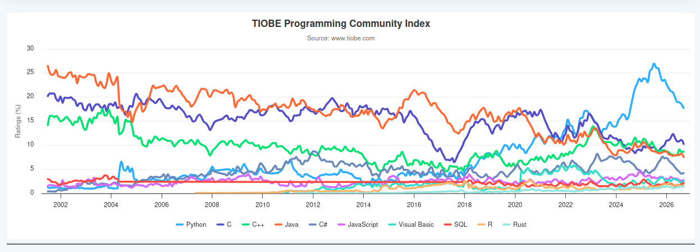  <!-- .element: width="1800px"; class="fragment" -->

Notes:
Et ça semble se voir déjà dans le TIOBE Index (merci Alexander) : tous les langages majeurs ont perdu en popularité, au profit de la longue tail. Le top 20 a perdu 12%.
Python n'a plus le monopole du haut niveau, puisque maintenant y'a le prompt-coding.

---

## Conclusion

🤷  <!-- .element: style="font-size:8em"; class="fragment" -->

🤔 <!-- .element: style="font-size:8em"; class="fragment" -->

---

## Crédits images et photos

<!-- .slide: class="credits" -->

* **Randall Munroe** — xkcd #353 « Python » — [xkcd.com](https://xkcd.com/353/) — CC BY-NC 2.5
* **Mateo21 (Mathieu Nebra)** — Site du Zéro v3 — [Wikimedia Commons](https://commons.wikimedia.org/wiki/File:Site_du_Z%C3%A9ro_v3.png) — CC BY-SA 3.0
* **Conan.io developers** — Logo Conan — [Wikimedia Commons](https://commons.wikimedia.org/wiki/File:Conan_package_manager_logo.png) — MIT
* **Les auteurs de PyCAM** — Captures de PyCAM — [pycam.sourceforge.net](https://pycam.sourceforge.net/) — GPLv3
* **nedbat, Petr Viktorin, Hugo van Kemenade** — Versions de Python — [devguide.python.org](https://devguide.python.org/versions/) — CC0
* **TIOBE Software BV** — Index TIOBE — [tiobe.com](https://www.tiobe.com/tiobe-index/) — © TIOBE
* **EuroPython Conference** — Photo « 3K6A4094 » — [Flickr](https://www.flickr.com/photos/europython/55514586938/) — CC BY-NC-SA 4.0
* **Marie Berbel (Kaizen Solutions)** — Photo du portrait (mon logo) — © Kaizen Solutions
* **ByteByteGo** — Schéma d'architecture micro-services « théorique » — [bytebytego.com](https://bytebytego.com/guides/what-does-a-typical-microservice-architecture-look-like/) — CC BY-NC-ND 4.0
* **Julien Lenormand** — Schéma d'architecture micro-services « réelle » — fait avec Excalidraw
* **Antonio Guillem** — Photo « Distracted Boyfriend » (mème) — [Wikipedia](https://en.wikipedia.org/wiki/Distracted_boyfriend) — © Antonio Guillem
* **NBC / Universal Television** — *The Office*, « They're the same picture » (mème) — © NBC Universal
* **abby-design** — Clipart d'escargot (mème) — [Vecteezy](https://www.vecteezy.com/vector-art/19943253-spring-snail-cartoon-colored-clipart-illustration) — Vecteezy Free License
* **Harsha et Animesh (MyCodeSchool), freeCodeCamp.org** — Miniature « Pointers in C / C++ » — [YouTube](https://www.youtube.com/watch?v=zuegQmMdy8M) — © tous droits réservés
* **Rails World / 37signals** — Keynote de DHH, Rails World 2026 — [YouTube](https://www.youtube.com/watch?v=vDjW_dRyKXY)
* **Fabrice Brochain (CommentCaMarche)** — Boîte de dialogue Windows — [commentcamarche.net](https://www.commentcamarche.net/informatique/windows/27477-reparer-ou-reinitialiser-une-application-windows-qui-plante/) — interface © Microsoft
* **PyChina** — Logo PyCon China — [pychina.org](https://pychina.org/) — © PyChina
* **Les auteurs de Poetry** — Logo Poetry — [python-poetry.org](https://python-poetry.org/) — © Poetry
* **Python Software Foundation** — Logo Python — [python.org](https://www.python.org/) — © PSF
* **Travian Games GmbH** — Capture de Travian — [Wikipedia](https://en.wikipedia.org/wiki/File:Map_view_resource_travian.jpg) — © Travian Games
* **Équipe de ff7.fr, Square Enix** — Capture de ff7.fr — [ff7.fr](https://www.ff7.fr/) — © leurs ayants droit
* **GitHub** — Capture de python/cpython — [github.com](https://github.com/python/cpython/issues) — © GitHub


---

## Extra

<!-- .slide: class="extra" -->

* **Satwik Kansal** — wtfpython : une collection de snippets affreux — [github.com](https://github.com/satwikkansal/wtfpython)
* **EuroPython** — chaque année, un quiz dément
* **Cameron K.** — Python sucks — [cameron.rs](https://cameron.rs/blog/python-sucks/)
* **Oleksandr Kaleniuk** — Outperforming everything with anything — [wordsandbuttons.online](https://wordsandbuttons.online/outperforming_everything_with_anything.html)
* **Guido van Rossum** — Typing situation — [YouTube](https://youtu.be/_SRFZODQtxw)
* **Abeba NGWE** — My toxic relationship with AI — [YouTube](https://www.youtube.com/watch?v=mm483y0Y0AM)
* **r/Python (Reddit)** — « What do you hate most about Python? » — [reddit.com](https://www.reddit.com/r/Python/comments/w7lpxi/what_do_you_hate_most_about_python/)
* **Axopen** — Podcast « Langages de programmation : quel avenir face à l'IA ? » — [axopen.com](https://www.axopen.com/podcast/langages-de-programmation-quel-avenir-face-a-lia)

---

## Des questions ?

https://github.com/Lenormju/talk-relation-toxique-python

  <!-- .element: width="900px" -->

---

## Abstract

> Python a été mon premier amour (en termes de langage de programmation).  
> Et les étapes se sont enchaînées naturellement (premier stage, premier CDI, première PyCon, ...).
>
> Mais au bout de 15 ans, je trouve qu'il a changé ; j'ai changé aussi. Je ne lui trouve plus les mêmes attraits. Il a même parfois des comportements que je désapprouve.
>
> Notre couple est en crise. Est-ce que je reste avec lui par confort ? Est-ce que notre relation peut être encore sauvée ?
>
> Venez vous assoir sur le divan avec moi, il faut qu'on parle ... 
